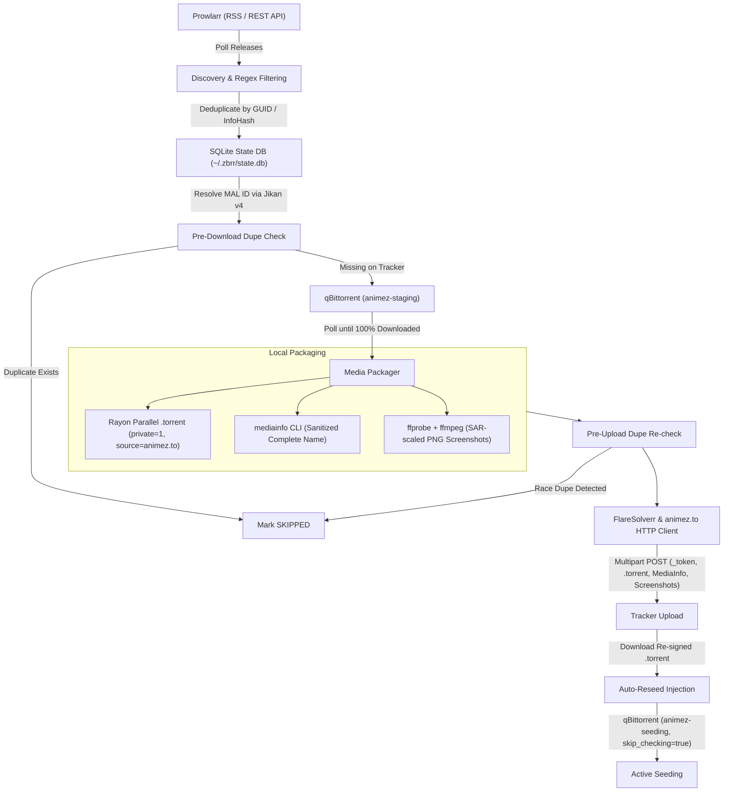

# zbrr — Automated AnimeZ RSS/API Pipeline

[](https://www.rust-lang.org/)
[](LICENSE)
[]()

**`zbrr`** is a high-performance, single-binary automation service and CLI tool written in **Rust**. It monitors **Prowlarr** (via REST API or Torznab RSS) for anime releases, verifies against **animez.to** (AvistaZ network codebase) to avoid duplicates, downloads missing releases via **qBittorrent**, packages media (parallel Bencode `.torrent` creation, MediaInfo extraction, SAR-aware FFmpeg screenshots, and MyAnimeList metadata), uploads the release to **animez.to** backed by **FlareSolverr** and session cookies, and automatically injects the tracker's re-signed `.torrent` back into qBittorrent for immediate, check-free seeding.

---

## Architecture & Pipeline Flow

Every release discovered from Prowlarr is tracked in an embedded **SQLite WAL** database (`~/.zbrr/state.db`) and moves through a strict, idempotent state machine:

```
DISCOVERED ──► DUPE_CHECKED ──► DOWNLOADING ──► PACKAGING ──► UPLOADING ──► SEEDING
     │               │               │              │             │
     ▼               ▼               ▼              ▼             ▼
  (Filters)       SKIPPED          FAILED         FAILED        FAILED
```



---

## Features

- **Prowlarr Integration**:
  - Dynamically resolves indexers by friendly name (e.g. `Nyaa.si`, `1337x`) or numeric IDs via `/api/v1/indexer`.
  - Automatically detects the **AnimeZ** tracker indexer and excludes it from source release polling while using it for fast API duplicate checks.
  - Supports both REST API (`/api/v1/search`) and Torznab XML RSS feeds.
  - Granular filtering: include/exclude regex, release group whitelist, resolution, source media (`WEB-DL`, `BluRay`), video codec (`HEVC`, `H.264`), min seeders, and size bounds.
- **Intelligent Deduplication**:
  - Custom Anitopy-style anime filename tokenizer extracting titles, season/episode, batch indicators, codecs, audio, and CRC32.
  - Resolves canonical MyAnimeList (MAL) metadata via Jikan v4 with local SQLite TTL caching.
  - Checks remote duplicates via Prowlarr AnimeZ indexer query and direct `animez.to/torrents` HTML scraping.
  - Double-checks duplicates right before upload to prevent race conditions during long downloads.
- **qBittorrent WebUI v2 Management**:
  - Stateless Bearer API key authentication (`Authorization: Bearer <api_key>`) for modern qBittorrent (v5.2.0+).
  - Categorizes staging downloads under `animez-staging`.
  - Preserves original source seeding and injects tracker-signed torrents under `animez-seeding` with `skip_checking=true`.
  - Docker/WSL/NAS path mapping (`remote_path_prefix` to `local_path_prefix`).
- **High-Speed Media Packaging**:
  - **Multi-threaded Torrent Creator**: Hashes pieces in parallel across all CPU cores using `rayon` + `sha1`. Generates strict BitTorrent Bencode dictionary ordering, `private=1`, and `source="animez.to"`. Automatic power-of-two piece sizing (256 KiB to 16 MiB). Excludes OS junk (`Thumbs.db`, `.DS_Store`).
  - **MediaInfo Extractor**: Invokes `mediainfo` binary with direct argument escaping and strips local disk directories from `Complete name`.
  - **SAR-Scaled Screenshots**: Uses `ffprobe` for duration and `ffmpeg` to extract full-resolution high-quality screenshots (JPEG by default, WebP/PNG supported) evenly spaced across video timestamps with aspect-ratio correction (`scale=iw*sar:ih`). Keeps multipart upload payload under 1.5 MB to avoid HTTP 413 limits.
- **Cloudflare & Tracker Session Resilience**:
  - Integrates with **FlareSolverr** to solve Cloudflare challenges on demand.
  - Caches `cf_clearance` and the exact matching `User-Agent` in `~/.zbrr/cookies.json`.
  - Automatically logs in via `animez.to/login` (extracting Laravel CSRF `_token`) if cookies expire or are missing.
  - Enforces polite request delays with configurable jitter (2–5 seconds).
- **Safety First (`--dry-run` & `inspect-form`)**:
  - Safe dry-run mode executes discovery, duplicate checks, download, and local packaging without posting to the live tracker.
  - `inspect-form` subcommand fetches and parses the live `animez.to/upload` HTML form to verify field IDs and schema changes.

---

## Prerequisites

1. **Rust Toolchain**: Rust 2021 edition (`rustc`, `cargo` 1.75+).
2. **External CLI Utilities** (must be installed and available in your `PATH` or configured via `.env` variables):
   - **`ffmpeg`** and **`ffprobe`**: Required for screenshot generation.
   - **`mediainfo`** (CLI): Required for MediaInfo text extraction.
3. **Services**:
   - **Prowlarr** (v1.0+)
   - **qBittorrent** (v5.2.0+ recommended for WebUI API keys)
   - **FlareSolverr** (v3.0+, running on e.g. `http://localhost:8191`)
   - An active account on **animez.to** (Username, Password, and Personal ID / PID)

---

## Installation

### 1. Download & Install (Prebuilt Binary)

Install the latest prebuilt release binary directly into your system `PATH`:

```bash
# One-line installer:
curl -fsSL https://raw.githubusercontent.com/jhnnr/zbrr/main/install.sh | bash

# Or run locally:
chmod +x install.sh
./install.sh

# Or install system-wide with sudo:
./install.sh --system
```

---

### 2. Build from Source

Clone the repository and build the optimized release binary:

```powershell
# Clone the repository
git clone https://github.com/jhnnr/zbrr.git
cd zbrr

# Build release binary
cargo build --release
```

The compiled binary will be located at:
- **Windows**: `target\release\zbrr.exe`
- **Linux**: `target/release/zbrr`

*(Optional)* Copy the executable to a directory in your system `PATH` (such as `/usr/local/bin` or `~/.local/bin`).

---

## Configuration

`zbrr` is configured entirely through a single `.env` file (or `~/.zbrr/.env`) and system environment variables. No complicated config files or external formats are required!

All runtime data (`state.db`, `cookies.json`, `upload_form_schema.json`, and `staging/`) is stored by default in `~/.zbrr` (on Windows: `C:\Users\<user>\.zbrr`, on Linux: `/home/<user>/.zbrr`).

> [!NOTE]
> **Automatic Migration**: If upgrading from an older version that stored files in `./data/`, `zbrr` automatically detects and migrates `data/state.db` and `data/cookies.json` to `~/.zbrr/` on startup.

### 1. Initial Setup

Copy the template secrets and configuration file:

```powershell
cp .env.example .env
```

> [!IMPORTANT]
> `.env` is listed in `.gitignore`. Never commit credentials, API keys, or session cookies to version control.

### 2. Environment Settings (`.env`)

Edit `.env` with your endpoints and credentials:

```dotenv
# Logging level (trace, debug, info, warn, error)
RUST_LOG=zbrr=info

# Storage directory (defaults to ~/.zbrr)
ZBRR_DATA_DIR=~/.zbrr

# Prowlarr API configuration
ZBRR_PROWLARR_URL=http://prowlarr.lan:9696
ZBRR_PROWLARR_API_KEY=your_prowlarr_api_key_here
ZBRR_PROWLARR_INDEXERS=Nyaa.si
ZBRR_PROWLARR_CATEGORIES=5070

# qBittorrent WebUI settings (v5.2.0+ Bearer API Key)
ZBRR_QBITTORRENT_URL=http://localhost:8080
ZBRR_QBITTORRENT_API_KEY=your_qbittorrent_api_key_here

# Path mapping: Required when qBittorrent runs in Docker/WSL/NAS and zbrr runs on Windows host.
# ZBRR_QBITTORRENT_REMOTE_PATH_PREFIX=/downloads
# ZBRR_QBITTORRENT_LOCAL_PATH_PREFIX=\\qbit.lan\downloads

# Jikan (MyAnimeList) metadata resolver
ZBRR_JIKAN_ENABLED=true

# FlareSolverr endpoint
ZBRR_FLARESOLVERR_URL=http://localhost:8191/v1

# AnimeZ tracker credentials
ZBRR_ANIMEZ_BASE_URL=https://animez.to
ZBRR_ANIMEZ_USERNAME=your_animez_username_here
ZBRR_ANIMEZ_PASSWORD=your_animez_password_here
# Personal ID (PID) from your animez.to profile
ZBRR_ANIMEZ_PID=your_animez_pid_here

# Optional: manual session cookie overrides
ZBRR_ANIMEZ_SESSION_COOKIE=
ZBRR_ANIMEZ_REMEMBER_COOKIE=
```

See [`.env.example`](.env.example) for the full list of available options, including release filters (`ZBRR_FILTERS_ALLOWED_GROUPS`), size bounds, and external packaging binary paths.

---

## Usage

### 1. Test Dependencies & Connections (`doctor`)

Verify that all external binaries (`ffmpeg`, `ffprobe`, `mediainfo`) are in `PATH` and test connectivity to Prowlarr, qBittorrent, FlareSolverr, and AnimeZ:

```powershell
cargo run -- doctor
# or using compiled binary:
zbrr doctor
```

Example output:
```text
=== AnimeZ (zbrr) Connectivity & Dependency Check ===

[1/5] External Media Packaging Binaries:
  [OK]   ffmpeg (ffmpeg): ffmpeg version 8.0.1
  [OK]   ffprobe (ffprobe): ffprobe version 8.0.1
  [OK]   mediainfo (mediainfo): MediaInfo Command line, v24.11

[2/5] SQLite State Database:
  [OK]   SQLite WAL database initialized at C:\Users\johnn\.zbrr\state.db

[3/5] Prowlarr Server (http://prowlarr.lan:9696):
  [OK]   Prowlarr v2.7.0.5723
         Configured indexers (5): 1337x [#4], AnimeZ [#6], AvistaZ [#5], EZTV [#2], Nyaa.si [#8]
         Active source indexers (1): Nyaa.si [#8]
         AnimeZ dupe-check indexer: AnimeZ [#6]

[4/5] qBittorrent WebUI (http://localhost:8080):
  [OK]   qBittorrent v5.2.0

[5/5] FlareSolverr (http://localhost:8191/v1) & Tracker (https://animez.to):
  [OK]   FlareSolverr 3.3.21 (HTTP 200 OK)
  [OK]   AnimeZ.to: Reachable (title='AnimeZ - Private Torrent Tracker', authenticated=true)
```

---

### 2. Inspect AnimeZ Upload Form Schema

Dump the live HTML form structure (including form actions, input fields, CSRF tokens, and dropdown options) from `https://animez.to/upload` to inspect or debug tracker form changes:

```powershell
# Live fetch via FlareSolverr + session cookies (defaults to ~/.zbrr/upload_form_schema.json)
zbrr inspect-form

# Or specify a custom output path or inspect an offline HTML dump
zbrr inspect-form --output ~/.zbrr/upload_form_schema.json
zbrr inspect-form --from-html path/to/upload.html --output ~/.zbrr/form_schema.json
```

---

### 3. Test Local Packaging (Standalone)

Verify torrent creation, MediaInfo extraction, and screenshot capturing on an existing local video file or directory:

```powershell
# Package a single episode
zbrr package-local "F:\Downloads\Anime\[SubsPlease] Dandadan - 07 (1080p) [1234ABCD].mkv"

# Package a season folder without screenshots
zbrr package-local "F:\Downloads\Anime\[Judas] Cyberpunk Edgerunners (Season 1) [1080p]" --skip-screenshots
```

Outputs will be generated under `~/.zbrr/staging/<release_name>/`:
- `<release_name>.torrent` (private=1, source="animez.to")
- `mediainfo.txt` (sanitized paths)
- `screenshot_01.jpg` ... `screenshot_04.jpg` (default high-quality JPEG `-q:v 2`, configurable to WebP or PNG)

---

### 4. Run Pipeline (Dry-Run Mode)

Test discovering releases from Prowlarr, running duplicate checks, downloading in qBittorrent, and packaging media locally **without** performing the final upload to AnimeZ:

```powershell
# Run a single cycle in dry-run mode
zbrr once --dry-run

# Run background daemon in dry-run mode
zbrr run --dry-run
```

---

### 5. Run Live Automated Pipeline

When ready, start the automation daemon or trigger a single cycle:

```powershell
# Single pass
zbrr once

# Continuous background daemon (polls every 300 seconds by default)
zbrr run

# Continuous daemon with custom 60-second polling interval
zbrr run --interval-secs 60
```

---

### 6. Monitor Status & Retry Releases

Query the internal SQLite database for tracked releases:

```powershell
# List recent releases
zbrr status

# Filter by state (DISCOVERED, DOWNLOADING, PACKAGING, UPLOADING, SEEDING, SKIPPED, FAILED)
zbrr status --state FAILED
zbrr status --state SEEDING --limit 20

# Retry a failed release by ID
zbrr retry 42

# Reset and process immediately
zbrr retry 42 --now
```

---

## Command Line Interface (CLI) Reference

```text
Usage: zbrr [OPTIONS] <COMMAND>

Commands:
  run               Start the continuous background polling daemon
  once              Run a single poll, download, package, and upload cycle
  inspect-form      Fetch animez.to/upload via FlareSolverr + cookies and dump HTML form schema to JSON
  doctor, test-connections  Verify external binaries (ffmpeg, ffprobe, mediainfo) and service connectivity
  package-local     Test creating a .torrent + MediaInfo + PNG screenshots on a local file or folder
  status, list      List tracked releases in the SQLite state database
  retry             Retry a FAILED or SKIPPED release by its database ID
  help              Print this message or the help of the given subcommand(s)

Options:
  -e, --env <ENV_FILE>   Optional path to environment file (.env) [default: .env or ~/.zbrr/.env]
      --dry-run          Global dry-run flag (executes discovery, dupe-check, download, and packaging without live upload POST)
  -h, --help             Print help
  -V, --version          Print version
```

---

## Directory Layout

```text
zbrr/
├── Cargo.toml                 # Rust dependencies & metadata
├── .env.example               # Template environment configuration
└── src/
    ├── main.rs                # Entrypoint & CLI dispatcher
    ├── cli.rs                 # Clap CLI commands and argument definitions
    ├── config.rs              # Configuration loader, tilde expansion & .env override mappings
    ├── models.rs              # Domain structs & ReleaseState state machine enum
    ├── db.rs                  # rusqlite database repository & WAL schema migrations
    ├── prowlarr.rs            # Prowlarr REST API & Torznab RSS client + indexer resolver
    ├── parser.rs              # Anime release filename parser + Jikan (MAL) API resolver
    ├── dupe_checker.rs        # AnimeZ duplicate release detection (Prowlarr & direct HTTP)
    ├── qbittorrent.rs         # qBittorrent WebUI v2 API client (Bearer auth, fast-resume reseed)
    ├── torrent_builder.rs     # Multi-threaded Rayon Bencode .torrent creator (private=1)
    ├── packager.rs            # FFmpeg screenshots, MediaInfo extraction & staging coordinator
    ├── flaresolverr.rs        # FlareSolverr client & cookie/User-Agent persistence
    ├── animez_client.rs       # AnimeZ HTTP scraper, CSRF token parser & multipart uploader
    └── pipeline.rs            # Async pipeline orchestrator connecting all stages

~/.zbrr/                       # User runtime directory (auto-created in user home)
├── .env                       # Optional global environment configuration
├── state.db                   # SQLite WAL database (releases, MAL cache)
├── cookies.json               # FlareSolverr / AnimeZ cached cookies & User-Agent
├── upload_form_schema.json    # Dumped tracker upload form schema (inspect-form)
└── staging/                   # Generated .torrent files, MediaInfo text, PNG screenshots
```

---

## Troubleshooting & FAQ

<details>
<summary><strong>1. qBittorrent API key authentication fails (HTTP 401 / 403)</strong></summary>

- Ensure qBittorrent is running **v5.2.0** or newer.
- In qBittorrent, open **Tools** -> **Options** -> **Web UI**.
- Under **Authentication**, ensure **API Key** is enabled and click **Generate**.
- Copy the key (`qbt_...`) and set it in `.env` as `ZBRR_QBITTORRENT_API_KEY=qbt_...`.
</details>

<details>
<summary><strong>2. Cloudflare challenge loop or 403 Forbidden on AnimeZ</strong></summary>

- Ensure **FlareSolverr** is running and reachable at the configured `url` (default: `http://localhost:8191/v1`).
- Verify `ZBRR_ANIMEZ_USERNAME` and `ZBRR_ANIMEZ_PASSWORD` are correct in `.env`.
- If FlareSolverr solved the challenge previously, check `~/.zbrr/cookies.json` to verify `cf_clearance` and `user_agent` are stored. You can delete `~/.zbrr/cookies.json` to force a clean re-authentication.
</details>

<details>
<summary><strong>3. Missing external binaries error during packaging</strong></summary>

- Run `zbrr doctor` to verify binary detection.
- If `ffmpeg`, `ffprobe`, or `mediainfo` are not in your system `PATH`, configure their absolute paths in `.env`:
  ```dotenv
  ZBRR_PACKAGER_FFMPEG_BIN=C:\Tools\ffmpeg\bin\ffmpeg.exe
  ZBRR_PACKAGER_FFPROBE_BIN=C:\Tools\ffmpeg\bin\ffprobe.exe
  ZBRR_PACKAGER_MEDIAINFO_BIN=C:\Tools\MediaInfo\mediainfo.exe
  ```
</details>

<details>
<summary><strong>4. Cross-platform path mapping between qBittorrent and zbrr</strong></summary>

- If qBittorrent runs in Docker/WSL (`/downloads/anime/...`) while `zbrr` runs natively on Windows (`F:\Downloads\anime\...`), configure prefix mapping in `.env`:
  ```dotenv
  ZBRR_QBITTORRENT_REMOTE_PATH_PREFIX=/downloads
  ZBRR_QBITTORRENT_LOCAL_PATH_PREFIX=F:\Downloads
  ```
</details>

---

## License

This project is licensed under the [MIT License](LICENSE).
